---
# Change the Date below
date: "2026-11-22"

# Add the title of the Post here
title: 'From Message Queues to Standard Rings (SRNGs): How CPUs talk with hardware at High Speeds'

# Add short description of the article for SEO optimization
description: "A beginner-friendly look at how firmware hands work between tasks and hardware: message queues, ring buffers, and the hardware descriptor rings (SRNGs) that let CPUs keep up with millions of jobs a second."

# replace the "sample/cover.png" with path to a 16:9 image
# this image will be shown in SEO optimization and when
# you share the post on social media.
thumbnail: "/posts/message-queues-to-srngs/cover.png"

# Add your GitHub handle here
author: "neeraj1397"

# Add tags as suitable for the topic
tags:
  - "RTOS"
  - "FreeRTOS"
  - "Ring Buffer"
  - "DMA"
  - "Device Drivers"
  - "Memory Barriers"

# If it fits a certain category of topics, add that
categories:
  - ""

# If this is a Series of posts, Add the name of the series
series: []
---

If you've written firmware on an RTOS, you've almost certainly used a message queue. One task puts a message in, another task takes it out, and the RTOS takes care of the waiting and waking. It's simple, and for most jobs it works fine. But what if the thing on the other side isn't a task? What if it's a piece of hardware, like a DMA engine, that needs a new job every microsecond? Hardware can't call `xQueueReceive()` or wait on a semaphore. All it can do is read and write memory. So how does the CPU keep handing it work that fast without the two of them getting in each other's way?

<!--more-->

The answer is a ring of memory that the CPU and the hardware share, with a few simple rules about who is allowed to touch what. You'll find the same idea in Ethernet controllers, USB, and NVMe drives, just under different names. In this article we'll start with message queues, since you already know them, and build up to SRNGs one small step at a time. You don't need any driver experience. If you understand a circular buffer, you'll be able to follow along.

## Two sides, one handoff

Take away the details and almost every piece of firmware has the same shape: one part creates work, and another part does it. A UART interrupt receives bytes and a parser task makes sense of them. An application task builds a packet and the network driver sends it. The CPU fills a buffer and a DMA engine moves it somewhere else. We call the first side the **producer** and the second side the **consumer**. The handoff between them is where things get interesting.

Think of a busy restaurant. Waiters take orders and clip them to a rail above the kitchen counter. Cooks pull orders off the rail, oldest first. The waiter never walks into the kitchen to explain an order, and the cook never comes out looking for the waiter. The rail is the whole agreement between them. As long as everyone knows where new orders go and which end to take them from, both sides can work at their own pace.

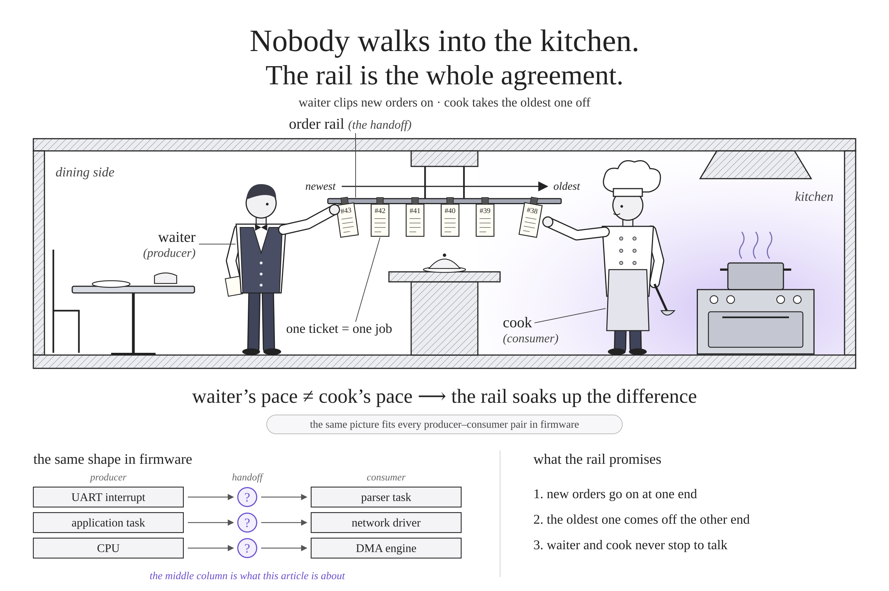

The rail has a cost, though. Every time a waiter clips an order, a few seconds pass. In a quiet café nobody notices. In a kitchen handling a thousand orders an hour, those seconds start to matter. Firmware works the same way. If a peripheral handles a million jobs a second, each job gets about one microsecond from start to finish. That has to cover preparing the job, handing it over, and dealing with the result. If the handoff itself takes a good part of that microsecond, there's very little left for the real work.

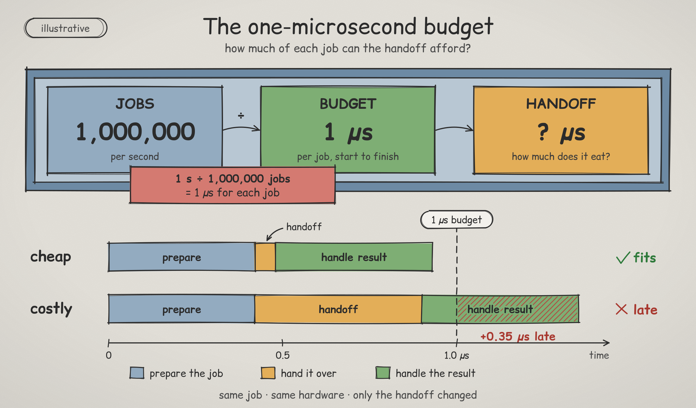

So the real question in this article is how cheap a handoff can be. Let's start with the tool most of us reach for first.

## Message queues: the tool you already know

If you've used FreeRTOS, Zephyr, or ThreadX, you've met a message queue. You create it with a fixed number of slots, one task puts messages in, and another task takes them out. In FreeRTOS it looks like this:

```c
QueueHandle_t jobQueue = xQueueCreate(16, sizeof(job_t));

/* Producer task */
job_t job = { .id = 42, .len = 128 };
xQueueSend(jobQueue, &job, portMAX_DELAY);

/* Consumer task */
job_t next;
xQueueReceive(jobQueue, &next, portMAX_DELAY);
```

Three lines of real work, and the RTOS does the rest. If the queue is empty, the consumer sleeps until something arrives. If the queue is full, the producer waits for a free slot. You don't have to think about timing at all, which is exactly why everyone likes queues.

But the RTOS isn't doing magic. Here's roughly what happens inside a single `xQueueSend()`:

1. **Lock the door.** The RTOS briefly blocks interrupts (this is called a *critical section*) so nothing else can touch the queue halfway through an update.
2. **Copy the message.** The whole `job_t` is copied into the queue's own memory. A 128-byte message means 128 bytes copied.
3. **Check if anyone is waiting.** If the consumer task was asleep waiting for data, the RTOS marks it as ready to run.
4. **Ask for a task switch.** If the task that just woke up has a higher priority, the RTOS flags that a switch is needed.
5. **Unlock the door, then switch.** Interrupts come back on, and the switch happens right away: the RTOS saves the current task's registers and loads the other task's.

`xQueueReceive()` goes through much the same steps from the other side: it locks, copies the message out, and unlocks. So every message gets copied twice, once going in and once coming out.

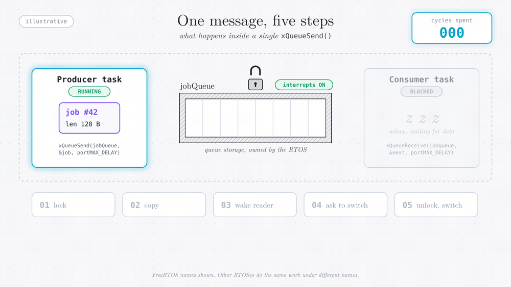

None of these steps is slow on its own. Together, they usually cost a few hundred CPU cycles per message, and often more when a task switch happens. For most firmware that's nothing. A button press, a sensor reading every 10 ms, or a command from a host PC fits into that budget with plenty of room to spare.

A quick side note: many engineers send a *pointer* to a job instead of the whole struct, so the queue copies 4 bytes instead of 128. Keep that trick in mind, because it comes back later in a big way.

Queues are great when:

- several tasks need to send to the same place
- the receiver should sleep until there's work to do
- you need timeouts ("wait at most 50 ms for a reply")
- messages arrive tens or hundreds of times a second, not millions

Now go back to the one-microsecond budget. Two problems show up.

The first is cost. A few hundred cycles per handoff, paid twice and sometimes with a task switch on top, takes a real share of that microsecond. That's the costly bar in the budget picture.

The second problem is bigger: **hardware can't use a message queue at all.** A DMA engine can't lock interrupts, can't be put to sleep and woken up by the scheduler, and has no idea what `xQueueReceive()` is. All it can do is read and write memory at addresses you give it.

So we need a handoff that's cheaper than a queue and also something hardware can take part in. To get there, we first need to look at what's hiding inside almost every queue: the ring buffer.

## The ring buffer hiding inside

Open up almost any message queue and you'll find something very simple inside: a plain array and two numbers.

The array holds the messages. The two numbers are positions in that array:

- **head** is where the producer will write the next message.
- **tail** is where the consumer will read the next message.

When the producer adds a message, it writes into the slot at `head` and moves `head` forward by one. When the consumer takes a message, it reads the slot at `tail` and moves `tail` forward by one. When either number reaches the end of the array, it wraps back to zero. That wrap is the whole trick. The array is a straight line in memory, but because the indexes loop around, it behaves like a circle. That's why it's called a *ring* buffer.

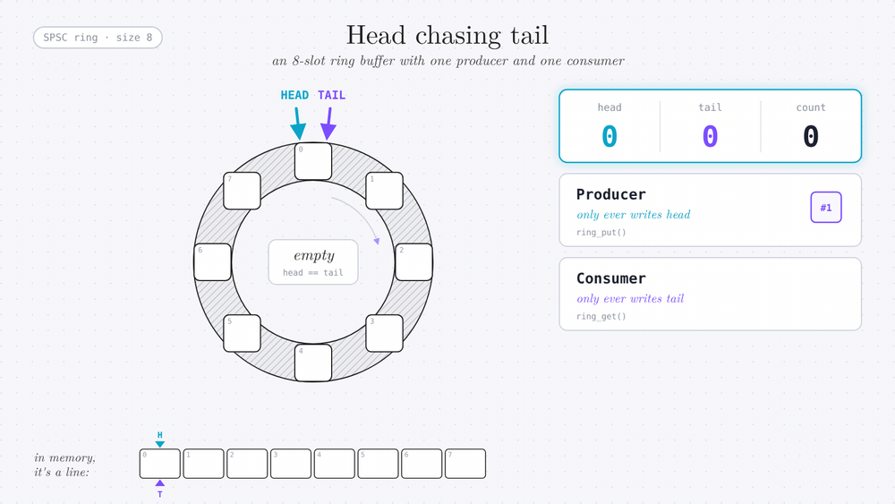

Two questions come up almost immediately.

**How do you tell "empty" from "full"?** If the ring is empty, head and tail point at the same slot. But if the producer filled every slot, head would come all the way around and land on tail again. The two states would look identical. The usual fix is to never fill the last slot. The ring counts as full when head is one step behind tail. You give up one slot, and in return the rule stays simple:

- `head == tail` → empty
- `head + 1 == tail` (after wrapping) → full

If you used all 8 slots, a full ring and an empty ring would look exactly the same: `head == tail`. The middle picture below shows that trap.

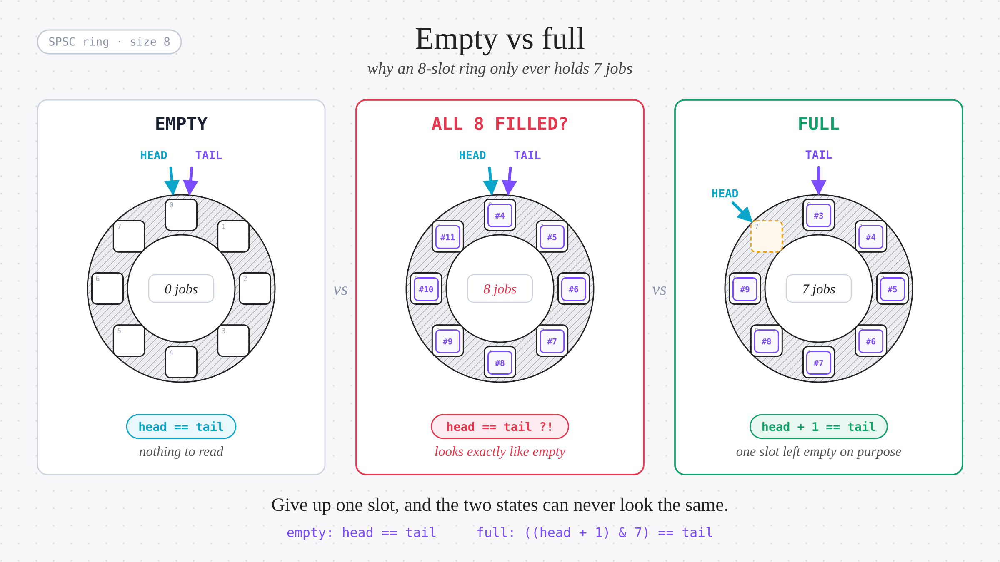

**Why are ring sizes almost always 8, 16, 64 or 256?** Because wrapping around is cheaper when the size is a power of two. Instead of `index % size`, which needs a divide, you can write `index & (size - 1)`, which is a single AND instruction. With a size of 8, `7 & 7` is 7 and `8 & 7` is 0. That's the wrap, done for free.

Here's a complete ring buffer in about twenty lines of C:

```c
#define RING_SIZE 8                     /* must be a power of two */

typedef struct {
    job_t    slots[RING_SIZE];
    uint32_t head;                      /* only the producer writes this */
    uint32_t tail;                      /* only the consumer writes this */
} ring_t;

bool ring_put(ring_t *r, const job_t *job)
{
    uint32_t next = (r->head + 1) & (RING_SIZE - 1);
    if (next == r->tail)
        return false;                   /* full */
    r->slots[r->head] = *job;           /* 1. write the data      */
    r->head = next;                     /* 2. then publish it     */
    return true;
}

bool ring_get(ring_t *r, job_t *out)
{
    if (r->tail == r->head)
        return false;                   /* empty */
    *out = r->slots[r->tail];
    r->tail = (r->tail + 1) & (RING_SIZE - 1);
    return true;
}
```

Look closely at the two comments on `head` and `tail`, because the rest of this article depends on them. **The producer is the only one that ever writes `head`. The consumer is the only one that ever writes `tail`.** Each side reads the other's number to see how much room or how much data there is, but it never changes it.

That one rule removes the need for a lock. In a message queue, the RTOS turns interrupts off because two parties might change the same thing at the same time. Here, nothing is shared for writing. The producer owns one number, the consumer owns the other, and they can't trip over each other. With one producer and one consumer, this ring needs no critical section, no RTOS call and no task switch. It's just a few loads and stores.

One honest warning: the code above is simplified to make the idea clear. Notice the order inside `ring_put()`. It writes the data first and moves `head` second. That order really matters, and on real hardware the CPU doesn't always keep it for you. We'll come back to this later, because it's the source of some of the nastiest bugs in this whole area.

So now we have a handoff with no lock and no RTOS involved. But both sides are still software, and the data is still being copied into the slot. What happens if the consumer isn't a task at all, but a piece of hardware that can only read memory? That's where the SRNG comes in.

## Enter the SRNG

Remember the trick from the queue section, where you send a pointer to the job instead of the whole job? An SRNG is built around exactly that idea.

**An SRNG (Standard Ring) is a ring buffer that lives in shared memory, where one side can be hardware.** The name comes from Qualcomm's Wi-Fi drivers; their public [Linux Wi-Fi guide](https://docs.qualcomm.com/doc/80-70020-14/topic/wlan_sw_overview.html) calls it the *Standard Ring Interface*. The CPU and a hardware block, like a DMA engine, both have access to the same piece of RAM. The ring sits in that RAM. One side produces entries, the other side consumes them, and the same rule from the last section holds: each side moves only its own pointer.

SRNGs even use the same names we've been using. Each ring has a **head pointer (HP)**, which only the producer moves, and a **tail pointer (TP)**, which only the consumer moves.

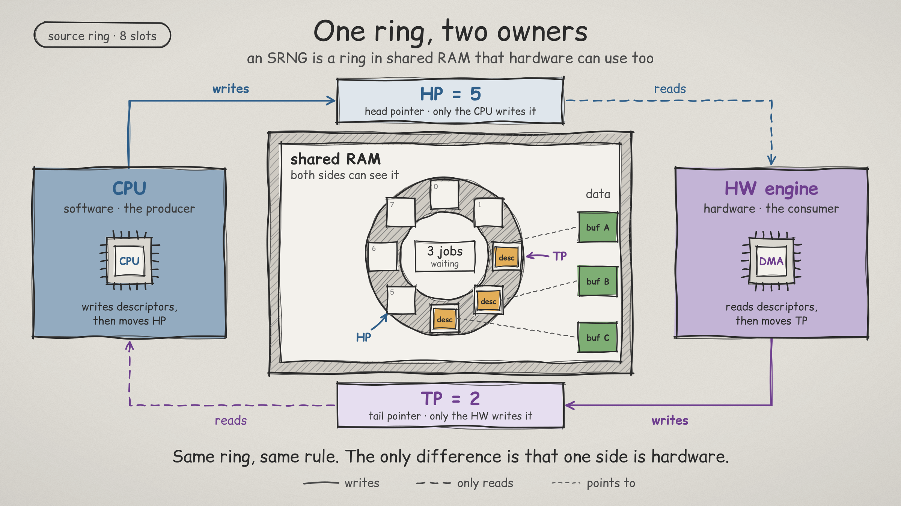

### Descriptors, not data

There's one big difference from the ring buffer in the previous section. In our C example, each slot held a full `job_t`, and putting a job in the ring meant copying all 128 bytes into the slot.

An SRNG doesn't do that. The actual data stays in its own buffer somewhere in RAM. What goes into the ring is a small, fixed-size record that *describes* the job. It's called a **descriptor**. A descriptor is a little note to the hardware: "the data is at this address, it's this many bytes, and here's what I want you to do with it."

A simple descriptor might look like this:

```c
typedef struct {
    uint32_t buf_addr_lo;   /* where the data lives        */
    uint32_t buf_addr_hi;   /* (upper half of the address) */
    uint16_t len;           /* how many bytes              */
    uint16_t flags;         /* what to do with it          */
} job_desc_t;               /* 12 bytes, no matter how big the data is */
```

Two things are worth noticing. First, the address in the descriptor is the address *as the hardware sees it on the bus*. On a small microcontroller this is usually the same number you'd see in your C pointer. On bigger chips with an MMU it can be different, and you'll often see it called a *physical* or *DMA* address. Second, the descriptor is the same small size whether the job is 64 bytes or 64 kilobytes. The ring never carries the data itself, so a bigger job doesn't make the handoff any slower.

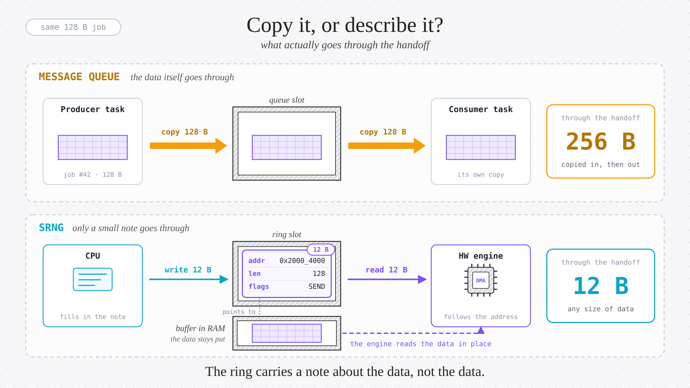

### Rings come in pairs

Data usually needs to flow both ways. The CPU sends work to the hardware, and the hardware reports back when it's done. So SRNGs usually come in pairs:

- A **source ring**, where software is the producer and hardware is the consumer. In our example this is the *request ring*: the CPU puts job descriptors in, and the engine takes them out.
- A **destination ring**, where hardware is the producer and software is the consumer. In our example this is the *completion ring*: the engine puts "job done" entries in, and the CPU takes them out.

The names "source" and "destination" are from software's point of view. Software is the source of what goes into a source ring and the destination of what comes out of a destination ring.

If you've worked with Ethernet controllers, NVMe drives or USB, you've already met this pattern under other names: descriptor rings, submission and completion queues, transfer rings. The details differ, but the idea is the same. A shared ring, small descriptors, and two pointers with clear owners.

There's one question left. Hardware can't call a function, so how does the engine *know* the CPU just added something to the ring? And how does the CPU find out a job is done? To answer that, let's follow one job all the way around.

## Life of a descriptor

Let's follow one job through our example: the CPU wants the engine to process 128 bytes sitting in a buffer. Two rings are involved. The **request ring** carries the job to the engine, and the **completion ring** carries the "done" message back.

### Part 1: CPU to hardware

**Step 1: Write the descriptor.** The data is already sitting in its buffer in RAM. The CPU fills in a descriptor (the buffer's address, the length, the flags) and writes it into the request ring, in the slot that HP points to. At this point the engine has no idea anything happened. The descriptor is just bytes in memory.

**Step 2: Make sure it's really there.** Before telling the engine about the new descriptor, the CPU has to be sure those bytes have actually landed in memory. CPUs and their caches sometimes delay or reorder writes to go faster. So the CPU issues a **memory barrier**, a single instruction that means "finish everything before this line before doing anything after it." We'll come back to why this matters so much. For now, just remember that it's there.

**Step 3: Ring the doorbell.** The CPU moves HP forward by one and writes the new value into a register inside the engine. That register write is the whole notification. There's no function call and no message. The engine watches its HP register, and the moment the value changes, it knows new work has arrived. This is why the head pointer register is often called a **doorbell**. You don't walk in and explain the order. You press the bell and walk away.

And the CPU really does walk away. It doesn't wait for the engine and it doesn't switch tasks. It goes back to whatever it was doing.

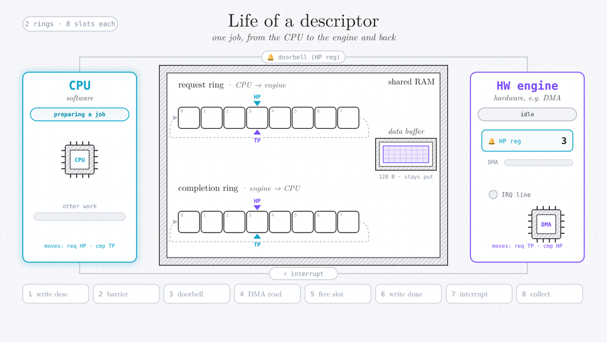

### Part 2: The engine does the work

**Step 4: Read the descriptor, then the data.** The engine sees that HP has moved past its TP, which means there's at least one entry it hasn't read yet. It reads the descriptor at TP, finds the buffer address inside, and uses DMA to read the 128 bytes straight from that buffer. The data never went through the ring.

**Step 5: Free the slot.** Once the engine is finished with the descriptor, it moves the request ring's TP forward. This is how the CPU learns that the slot can be reused. It's the same rule as before: the engine is the consumer of this ring, so it's the only one that moves TP.

### Part 3: Hardware back to CPU

Now the roles flip. On the completion ring, **the engine is the producer and the CPU is the consumer**.

**Step 6: Report the result.** The engine writes a small completion entry ("job done, status OK") into the completion ring at *that* ring's HP, then moves HP forward.

**Step 7: Tap the CPU on the shoulder.** The engine raises an **interrupt**. That's the hardware version of the doorbell, going the other way. (One interrupt for every job gets expensive at high rates. We'll fix that in the next section.)

**Step 8: Collect and acknowledge.** In its interrupt handler, the CPU reads completion entries from its TP up to the engine's HP, handles each one, and then moves TP forward so the engine knows those slots are free again.

Here's what both sides of the CPU's work look like in code. The register names are made up, but every real driver has these same two functions in some form:

```c
/* Send one job to the engine */
bool submit(const job_desc_t *d)
{
    uint32_t hp   = req_hp;                        /* our copy of HP        */
    uint32_t next = (hp + 1) & (REQ_SIZE - 1);
    if (next == REQ_TP)                            /* engine's TP: full?    */
        return false;

    req_ring[hp] = *d;                             /* 1. write descriptor   */
    __DMB();                                       /* 2. memory barrier     */
    req_hp = next;
    REQ_HP_REG = req_hp;                           /* 3. ring the doorbell  */
    return true;
}

/* Interrupt handler: collect finished jobs */
void completion_irq(void)
{
    uint32_t hp = CMP_HP;                          /* how far the engine got */
    __DMB();                                       /* read entries after HP  */
    while (cmp_tp != hp) {
        handle_done(&cmp_ring[cmp_tp]);
        cmp_tp = (cmp_tp + 1) & (CMP_SIZE - 1);
    }
    CMP_TP_REG = cmp_tp;                           /* 8. hand slots back     */
}
```

> [!NOTE]
> `__DMB()` is the Cortex-M memory barrier from CMSIS. In Linux drivers you'll see `dma_wmb()` or `wmb()` doing the same job.

Compare this with the `xQueueSend()` animation from earlier. There's no lock, no copy of the data, and no task switch on the handoff. There's a descriptor write, a barrier, and one register write. That's the whole cost of sending a job.

Look at the `while` loop in the interrupt handler, too. If three jobs finished before the CPU got around to the interrupt, it collects all three in one go and writes TP back once. That small detail is the key to the next section, where we look at what makes SRNGs fast.

## Why SRNGs are fast

We've already seen two of the speed tricks. The other three are less obvious, and they're what separate a ring that works from a ring that's fast.

**1. Nothing big gets copied.** Only a 12-byte descriptor goes into the ring. The data stays in its buffer, and the engine reads it from there directly. Whether the job is 64 bytes or 64 KB, the handoff costs the same.

**2. No locks.** Each pointer has exactly one owner, so the two sides never fight over anything. There's no critical section and no RTOS call, and nothing makes the CPU stop and wait.

**3. Batching.** Here's where that `while` loop comes in. Nothing forces you to ring the doorbell after every descriptor. If the CPU has five jobs ready, it can write all five descriptors, issue one barrier, and write HP once. The engine sees HP jump forward by five and starts working through them. The receiving side works the same way: the interrupt handler collects every finished entry it finds and writes TP back once at the end.

Why does that matter? Writing to a hardware register is one of the more expensive things the CPU does in this whole loop. Writing descriptors is just normal memory writes. So doing one register write for five jobs instead of five register writes is a real saving, and it grows as the traffic grows.

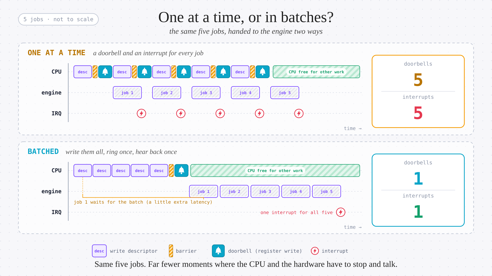

**4. Fewer interrupts.** Interrupts are expensive too. Every one makes the CPU stop what it's doing, save its state, run the handler, and then go back. If the engine finishes a million jobs a second and raises an interrupt for every one of them, the CPU will spend most of its time just entering and leaving interrupt handlers.

So most SRNG-style hardware lets you set two thresholds. The engine raises an interrupt only when **N entries** have piled up in the completion ring, or when **T microseconds** have passed since the first unread entry, whichever comes first. This is called **interrupt coalescing**. The count threshold keeps interrupts rare when traffic is heavy. The timer threshold makes sure a lonely single job doesn't sit there forever when traffic is light.

There's a trade-off, and it's worth saying out loud. Waiting for a batch adds a little delay to each job. Bigger batches mean less CPU overhead but slower response, and smaller batches mean the opposite. Tuning those two numbers is a big part of getting good performance out of a real driver. (Linux takes this one step further with NAPI: after the first interrupt, the driver turns interrupts off and simply polls the ring until it's empty. When traffic is heavy, that's cheaper than taking interrupts at all.)

**5. Reading pointers without touching the hardware.** This is the least obvious trick, and also the cleverest.

The CPU regularly needs to know where the engine's pointers are. On the request ring it reads TP to see which slots are free. On the completion ring it reads HP to see how much work is done. The obvious approach is to read those values straight from the engine's registers. But reading a hardware register is slow in a way that writing isn't.

When the CPU *writes* to a register, it can send the value off and keep going. It doesn't need to wait for an answer. When it *reads* a register, it has to stop and wait until the value comes all the way back. For a peripheral on the same small microcontroller, that wait is short. But when the hardware sits across a bus like PCIe, as Wi-Fi chips, NVMe drives and network cards usually do, a single register read can stall the CPU for hundreds of nanoseconds to around a microsecond. That's our entire per-job budget from the start of this article, gone on one read.

The fix is simple. **The engine copies its own pointer into a small spot in RAM every time it moves it.** The CPU reads that RAM location instead of the register. A RAM read is fast and doesn't touch the hardware at all. The engine has to do one extra write, but it does that on its side, without slowing the CPU down.

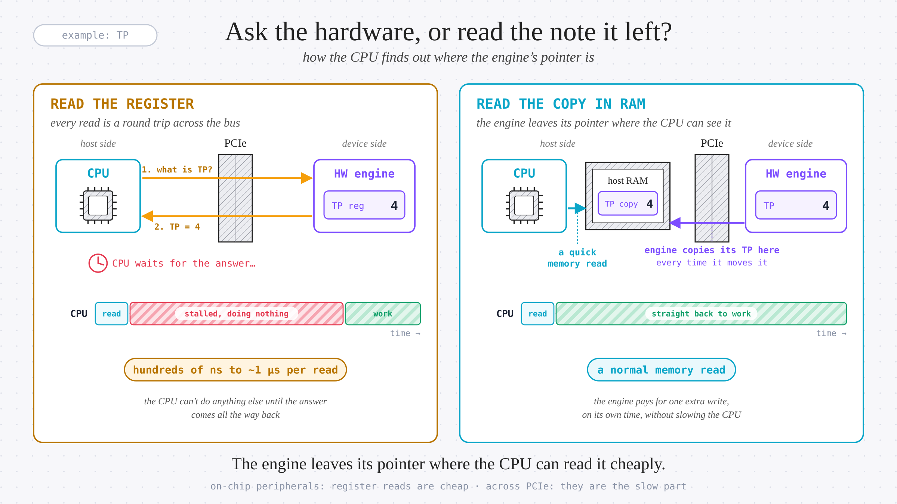

Some chips go a step further with **shadow registers**: an extra set of registers that are always easy for the CPU to reach, which the chip forwards to the real ring pointers behind the scenes. You'll see the name in the open-source Qualcomm Wi-Fi drivers. The details vary from chip to chip, but the goal is the same as everything else in this section: keep slow trips to the hardware off the fast path.

Put all five together and the cost of handing over one job comes down to a handful of memory writes, plus a share of one register write and one interrupt split across the whole batch. That's how a CPU keeps up with hardware moving millions of jobs a second.

If you've written an Ethernet driver on an STM32 or an NXP part, though, you might be thinking: *my descriptors don't have head and tail pointers at all. They have an OWN bit.* You're right. That's the other common way to build a hardware ring, and it's worth comparing the two.

## Pointer rings vs OWN-bit rings

An SRNG tracks the ring with two numbers: HP says how far the producer has written, and TP says how far the consumer has read. An OWN-bit ring doesn't keep pointers like that. Instead, **every descriptor carries a single bit that says who it belongs to right now.**

- **OWN = 1** means the descriptor belongs to the DMA. "Hands off, hardware is working on this."
- **OWN = 0** means it belongs to the CPU. "Hardware is done; you can read the result or reuse the slot."

Sending a packet on a typical microcontroller Ethernet MAC goes like this. The CPU fills in a descriptor's buffer address and length, then sets OWN = 1. The DMA walks around the ring. Whenever it finds a descriptor it owns, it sends that buffer, writes the result (status, bytes sent) back into the *same* descriptor, and clears OWN to 0. Later, the CPU walks the ring behind it and picks up every descriptor where OWN has gone back to 0.

```c
/* Give one descriptor to the DMA */
d->buf  = buf;
d->len  = len;
__DMB();                     /* everything else first...  */
d->ctrl |= DESC_OWN;         /* ...the OWN bit goes last  */
ETH_TX_POLL_REG = 1;         /* wake the DMA if it's idle */

/* Later: collect the ones the DMA is finished with */
while (clean != next && !(ring[clean].ctrl & DESC_OWN)) {
    tx_done(&ring[clean]);
    clean = (clean + 1) % RING_SIZE;
}
```

Two lines in that code should look familiar.

The first is the barrier just before OWN is set. It's the same rule as in the SRNG: write the descriptor first, publish it second. If the DMA sees OWN = 1 before the address and length have actually landed in memory, it will happily send garbage.

The second is the "poll demand" register write at the end. When an OWN-bit DMA reaches a descriptor it doesn't own, it usually stops and goes idle. Writing that register wakes it up to look again. That's a doorbell. It goes by a different name, but it does the same job.

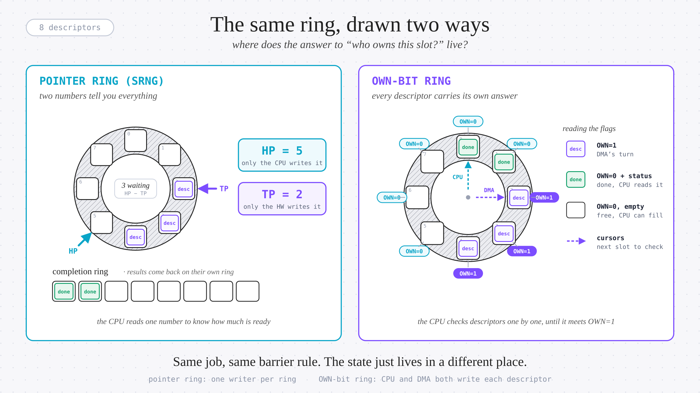

So which one is better? Neither. They put the "who owns what" information in different places, and each choice has consequences.

| | Pointer ring (SRNG) | OWN-bit ring |
|---|---|---|
| Where the state lives | Two pointers per ring | One bit inside every descriptor |
| How the CPU finds finished work | Reads one pointer, or its copy in RAM | Walks descriptors, checking each OWN bit |
| Where results go | Usually a separate completion ring | Written back into the same descriptor |
| Batching | Natural: one HP write covers many entries | Possible: one poll-demand write after many OWN bits |
| Who writes the descriptor memory | Only the producer | Both: CPU fills it, DMA writes status back |
| Where you'll usually see it | Wi-Fi, NVMe, high-speed NICs over PCIe | Microcontroller Ethernet, USB, SDIO |

The row about who writes the descriptor memory is the one that bites people. In an OWN-bit ring, the CPU and the DMA both write into the same descriptors. If the CPU has a data cache, it can end up holding a stale copy of a descriptor the DMA has just updated, or flush its own old copy on top of the DMA's fresh status. That's why so many STM32H7 and i.MX Ethernet examples place the descriptor memory in a region marked non-cacheable. If you've ever had to set that up with the MPU and wondered why, this is the reason.

Pointer rings mostly avoid that problem. Each ring has one writer, and results travel back on a separate ring, so the CPU and the hardware are never writing the same descriptor. That's part of why the high-speed designs that sit across PCIe tend to use pointer rings.

To be fair, the line between the two isn't strict. Some newer Ethernet controllers use both: an OWN bit in every descriptor *and* a tail-pointer register the CPU writes to say how far the ring has been filled. Once you understand the two pure designs, the mixed ones are easy to read.

Both designs, though, share the same sharp edges, and those edges cause some of the hardest-to-find bugs in embedded software. Let's look at them.

## The sharp edges

Rings are fast because they cut out the middleman. No RTOS is checking your work, and nobody holds a lock for you. That also means nothing protects you when you get something wrong. Here are the five mistakes that cause the most trouble, roughly from most to least painful.

### 1. Writes that happen in the wrong order

Go back to the order of operations in `submit()`: write the descriptor, *then* ring the doorbell. In your C code those are two separate lines in the right order. The problem is that neither the compiler nor the CPU promises to keep them in that order.

The compiler sees a descriptor write to ordinary memory and a register write that, as far as C is concerned, have nothing to do with each other. It's allowed to rearrange them if it thinks that's faster. Many CPUs also have a *write buffer* that holds writes for a moment and may let a later one reach the bus before an earlier one. Either way, the engine can receive the doorbell before the descriptor has actually reached memory. It reads the slot, finds half of a descriptor, or last time's stale one, and does exactly what that garbage tells it to do.

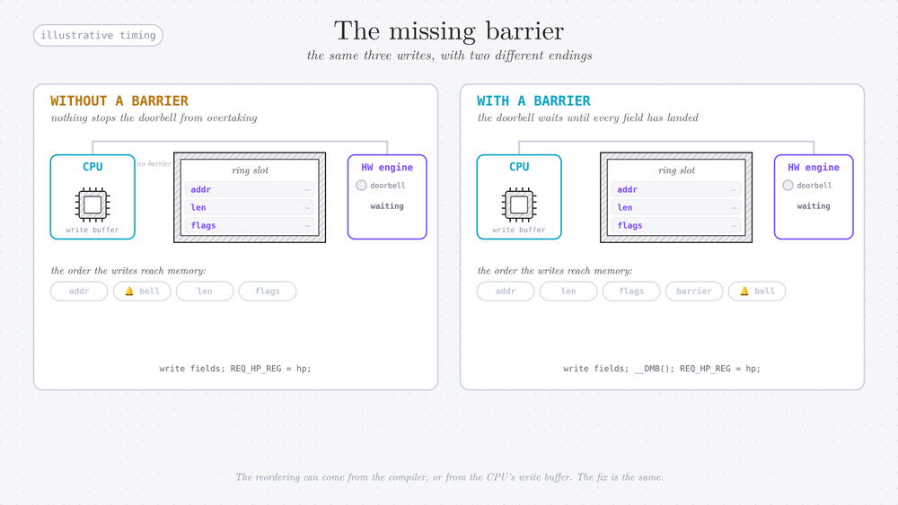

**What you'll see:** random corruption, occasional hardware errors, or the engine sending the previous job twice. The bug often goes away when you add a `printf` or build with `-O0`, because both change the timing and the code order. That's a strong sign of a missing barrier.

**The fix:** put a memory barrier between "write the descriptor" and "publish it": `__DMB()` on Cortex-M, or `dma_wmb()` / `wmb()` in Linux drivers. A barrier like this is also a *compiler* barrier, so it stops both kinds of reordering at once. The reading side needs one too. After the CPU reads the engine's HP from the completion ring, it needs a barrier before reading the entries, so it doesn't read an entry before the engine has finished writing it. That's the second `__DMB()` in the interrupt handler.

> [!IMPORTANT]
> **Write the data, barrier, publish the pointer. Read the pointer, barrier, read the data.**

### 2. The cache keeps a different copy

Many microcontrollers have a data cache: Cortex-M7 parts like the STM32F7 and H7, and the i.MX RT series. The cache makes the CPU fast by keeping recently used memory close by. But the DMA engine doesn't look in the CPU's cache. It reads and writes RAM directly.

That causes two problems that are mirror images of each other:

- **CPU writes, hardware reads.** The CPU writes a descriptor or a buffer, but the new bytes are still sitting in the cache and haven't reached RAM. The engine reads RAM and gets the old values.
- **Hardware writes, CPU reads.** The engine writes a completion entry or received data into RAM, but the CPU still has an old copy of that memory in its cache. It reads the old copy and never sees the new data.

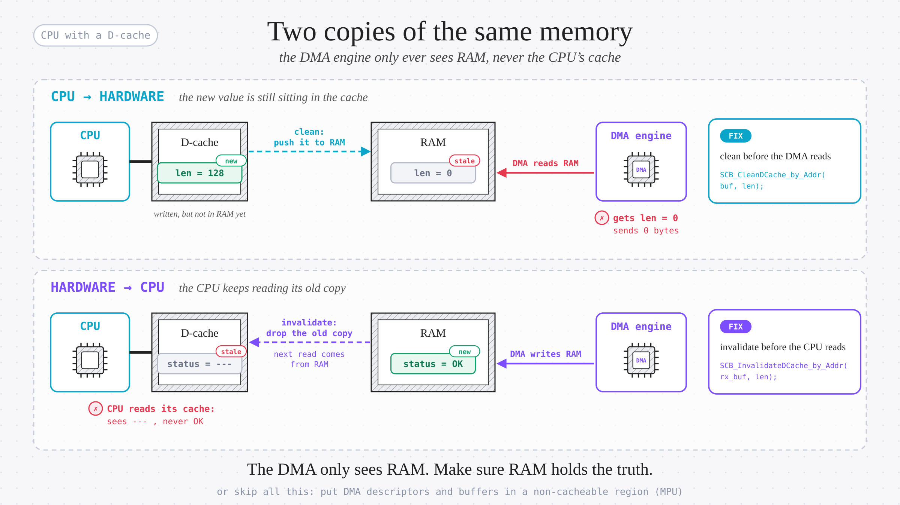

**What you'll see:** the hardware acts on old descriptors, received data looks like the previous packet, or the CPU never notices that a job finished. Like the barrier bug, it may only show up under load.

**The fix:** you have two options.

- Keep the descriptors and buffers in memory marked **non-cacheable** (on Cortex-M7, by setting up an MPU region). It's simple and safe, and it's what most vendor Ethernet examples do.
- Keep them cacheable and **maintain the cache by hand**: *clean* before the hardware reads, *invalidate* before the CPU reads what the hardware wrote.

```c
/* CPU wrote the buffer, hardware is about to read it */
SCB_CleanDCache_by_Addr((uint32_t *)buf, len);

/* hardware wrote the buffer, CPU is about to read it */
SCB_InvalidateDCache_by_Addr((uint32_t *)rx_buf, len);
```

> [!TIP]
> The cache works in whole *lines*, usually 32 bytes. If your buffer shares a cache line with some other variable, invalidating the buffer also throws away any pending update to that variable. Align DMA buffers to the cache line size and round their length up to whole lines.

### 3. The ring fills up

A ring has a fixed number of slots. Sooner or later the producer will be faster than the consumer for a while, and the ring will fill up. What you do next is a design decision, not something to discover in testing.

You have three honest choices: **drop** the new job and count it, **try again later**, or **tell whoever is upstream to stop sending** for now. Linux network drivers do the third one. They pause the transmit queue until completions free up some slots. The one thing you must never do is write into a slot the consumer hasn't freed yet. That's the `next == tail` check in the code, and skipping it overwrites a job the hardware may be reading at that very moment.

Don't forget the completion ring either. If the CPU falls behind on collecting completions, it's the *hardware* that runs out of space, and depending on the design it will either stall or drop results. Size your rings for your worst burst, not your average.

### 4. Two producers sneak in

The "no lock needed" promise only holds with exactly **one producer and one consumer**. The moment two tasks, two CPU cores, or a task and an interrupt handler both write descriptors into the same ring, they can both read the same HP, both write into the same slot, and both ring the doorbell. One job silently disappears.

It's easy to do this without noticing. A transmit function called from a task and from an ISR is already two producers.

**The fix:** either put a lock around the producer side (that's why the Linux ath11k driver takes a spinlock around its ring access), or, better for speed, give each producer its own ring. That's one reason high-performance hardware usually offers several transmit rings: one per core, with no sharing at all.

### 5. Nothing waits for you

A message queue can put a task to sleep until data arrives. A ring can't. It's just memory. Something has to decide when to check it: an interrupt, a polling loop, or a mix of the two.

Here's an ironic twist. In an RTOS system you'll often find a ring and a semaphore working side by side. The interrupt handler doesn't process the completions itself. It just gives a semaphore to wake a worker task, and the task drains the ring. The ring carries all the data at full speed, and the semaphore only carries the wake-up signal, once per batch. That's the right job for each tool: rings for the fast path, the RTOS for scheduling.

We've covered a lot of ground. Before we wrap up, let's put message queues and SRNGs side by side one last time.

## Side by side

Here's everything from this article in one place.

| | Message queue | SRNG |
|---|---|---|
| **What goes through the handoff** | The whole message, copied in and copied out | A small descriptor; the data stays where it is |
| **Locking** | The RTOS takes a short critical section on every send and receive | None, as long as there's one producer and one consumer |
| **Can hardware take part?** | No. Both sides must be software tasks | Yes. That's the whole point |
| **Waiting for data** | Built in: a task can sleep, with a timeout | Not built in: you need an interrupt, polling, or both |
| **How many producers** | As many as you like | One per ring (more needs a lock, or one ring each) |
| **Message size** | Fixed when you create the queue | Descriptors are fixed size; the data they point to can be any size |
| **Cost per item** | A few hundred cycles, more if a task switch happens | A few memory writes; the register write and interrupt are shared across a batch |
| **What can go wrong** | Mostly sizing and priorities. The RTOS protects you | Barriers, caches, full rings, extra producers. Nothing protects you |
| **Debugging** | Easy. Many debuggers can show queue contents directly | Harder. The bugs are timing bugs and often vanish when you look |
| **Where you'll see it** | Commands, events, sensor readings, state machines | Network packets, Wi-Fi, storage, audio, anything with DMA |

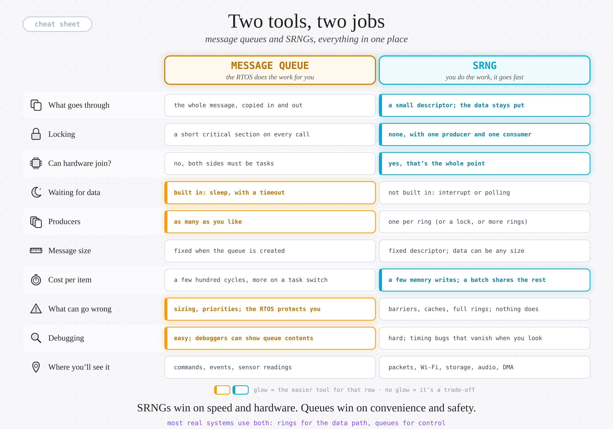

If you read the table as a scoreboard, SRNGs seem to win most rows. Read it again and look at *which* rows they win. They're about speed and hardware. The rows a message queue wins are about convenience and safety: sleeping until data arrives, several senders, and an RTOS that catches your mistakes.

That's the real difference. A message queue does a lot of work for you, and charges a little for it on every message. An SRNG does almost nothing for you, and that's exactly why it's so cheap. You pay instead with care: barriers in the right places, cache maintenance, and a clear answer to "what happens when the ring is full?"

Neither one is the better tool. They're tools for different jobs, and most real systems use both. The interesting question is how to decide which one a given job needs.

## When to use which

You'll rarely sit down and choose between these from scratch. Most of the time the situation picks for you, and you just need to recognize it. Three questions cover almost every case.

**1. Is one side hardware?** Then it's a ring. You don't really get a choice here, because the hardware defines the ring format, the descriptor layout and the doorbell register. Your job is to write the software side correctly: barriers in the right places, caches handled, and a plan for when the ring is full.

**2. Both sides are software. Do you need more than one sender, a task that sleeps until data arrives, or a timeout?** Then use a message queue. This covers most of the communication in a typical firmware project: commands from a shell, events from buttons, readings from a sensor every few milliseconds, messages between state machines. At these rates, the few hundred cycles a queue costs don't matter, and everything it gives you, the sleeping, the timeouts, several senders, the protection, is worth having.

**3. One sender, one receiver, and lots of data?** Think of audio samples coming from an I2S interrupt, bytes streaming in from a UART, or log messages headed for a slow output. A software ring like the one in the next section is the right tool here. Pair it with a lightweight wake-up, like a semaphore or a task notification given once per batch, so the receiving task can sleep when there's nothing to do. If you use FreeRTOS, its **stream buffers** and **message buffers** are exactly this: a ring for one writer and one reader, with the wake-up built in.

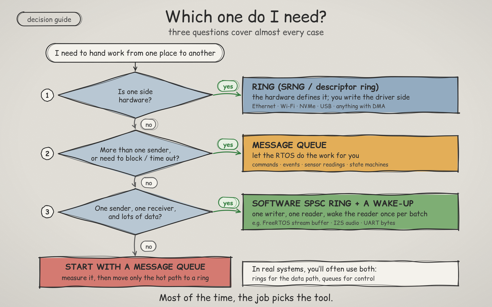

If you can't decide, start with a message queue. It's simpler and safer, and the RTOS will catch many of your mistakes. Measure your system. If profiling shows that one particular handoff is eating real time, move just that path to a ring. You'll know exactly why you're doing it, and you'll go in with your eyes open about the sharp edges.

In practice, most real systems end up using both, side by side. A network or Wi-Fi driver is a good example. Packets flow between the CPU and the hardware through rings, at full speed, millions of times a second. Right next to them, a control task receives configuration changes, connection events and error reports through an ordinary message queue, a few times a second. Each tool is doing the job it's good at.

## Try it yourself

Here's a complete single-producer, single-consumer ring in plain C11. It uses the same head-and-tail rules as everything else in this article, plus one addition: proper atomic operations, so it's correct on real multi-core hardware and not just in a diagram. The full file, [spsc_ring.c](spsc_ring.c), includes a demo that sends a million jobs between two threads and checks every one. It compiles with one command:

```bash
gcc -O2 -std=c11 -pthread spsc_ring.c -o spsc_ring && ./spsc_ring
```

Here's the ring itself:

```c
#define RING_SIZE 8u                 /* must be a power of two */
#define MASK      (RING_SIZE - 1u)

typedef struct {
    job_t            slots[RING_SIZE];
    _Atomic uint32_t head;           /* only the producer writes this */
    _Atomic uint32_t tail;           /* only the consumer writes this */
} ring_t;

bool ring_put(ring_t *r, const job_t *job)
{
    uint32_t head = atomic_load_explicit(&r->head, memory_order_relaxed);
    uint32_t next = (head + 1) & MASK;

    if (next == atomic_load_explicit(&r->tail, memory_order_acquire))
        return false;                                  /* full */

    r->slots[head] = *job;                             /* 1. write the data  */
    atomic_store_explicit(&r->head, next,
                          memory_order_release);       /* 2. then publish it */
    return true;
}

bool ring_get(ring_t *r, job_t *out)
{
    uint32_t tail = atomic_load_explicit(&r->tail, memory_order_relaxed);

    if (tail == atomic_load_explicit(&r->head, memory_order_acquire))
        return false;                                  /* empty */

    *out = r->slots[tail];                             /* 1. read the data   */
    atomic_store_explicit(&r->tail, (tail + 1) & MASK,
                          memory_order_release);       /* 2. then free slot  */
    return true;
}
```

Those `memory_order` words might look scary, but you already know what they mean. They're the barrier rule from the sharp-edges section, written in a form the compiler understands:

- **`memory_order_release`** on a store means "every write before this line is finished before this store becomes visible." It's *write the data, barrier, publish the pointer*, in one line.
- **`memory_order_acquire`** on a load means "nothing after this line may happen before this load." It's *read the pointer, barrier, read the data.*
- **`memory_order_relaxed`** is for a side reading its *own* pointer. Nobody else writes it, so there's nothing to order.

The same code works on a microcontroller. Make the main loop the producer and an interrupt handler the consumer (or the other way round), and `arm-none-eabi-gcc` will compile the atomics. On a single-core Cortex-M, the main thing they do is stop the compiler from reordering. That's exactly the bug from the missing-barrier animation.

Once it runs, try breaking it on purpose. Each of these takes a minute and teaches more than reading about it:

1. **Change `RING_SIZE` to 7.** The mask trick only works for powers of two. Watch the jobs come out in the wrong order.
2. **Start a second producer thread.** Two producers break the one-writer rule. The error count is no longer zero.
3. **Change every `memory_order` to `relaxed`.** On an x86 laptop it will probably still pass, because x86 keeps writes in order more strictly than the C rules require. On a multi-core ARM board, like a Raspberry Pi, it can start failing. That's the best possible lesson in why "it works on my machine" means nothing for memory ordering.

If you want to keep going, here are some places to look next: the **virtio** specification, which describes a full descriptor-ring design used in virtual machines; the **NVMe** specification, with its submission and completion queues; the open-source Linux **ath11k** driver, whose `hal.c` contains a real SRNG implementation; and the FreeRTOS documentation on **stream buffers**.

## Takeaways

- **A message queue does the work for you,** copying, locking, sleeping, waking, and charges a little for it on every message. Use it whenever that cost doesn't matter, which is most of the time.
- **A ring gets its speed from one rule:** each side writes only its own pointer. No shared writes means no lock.
- **An SRNG is that ring with hardware on one side.** Descriptors instead of data, a doorbell instead of a function call, and batching to keep the expensive moments rare.
- **Speed comes with sharp edges.** Write the data, barrier, publish the pointer. Mind the cache. Know what happens when the ring is full. Never let a second producer sneak in.

The next time you open an Ethernet, Wi-Fi or storage driver and see two pointers chasing each other around an array, you'll know exactly what you're looking at, and why it's built that way.
